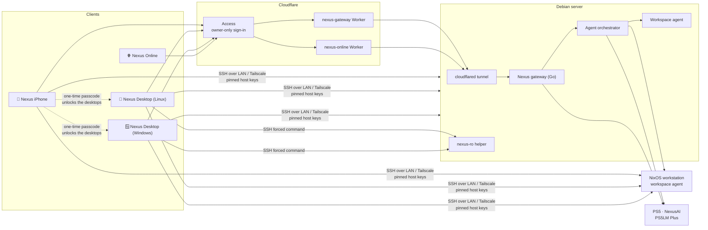

# Nexus

**Your home lab, everywhere.** 
One ecosystem for running Linux servers, AI models and your own code from an iPhone, a Linux or Windows desktop, or a browser, all behind one owner-only gateway.

[**nexus.liamjc.dev**](https://nexus.liamjc.dev) ·
[Docs](docs/README.md) ·
[Full setup](docs/SETUP.md) ·
[NexusAI](docs/backend/NEXUSAI.md) ·
[Architecture](docs/ARCHITECTURE.md) ·
[Debian backend](docs/backend/DEBIAN.md) ·
[Cloudflare](docs/backend/CLOUDFLARE.md) ·
[Security](docs/SECURITY.md)

---

## The apps

<table>
<tr>
<td width="50%" valign="top">

### 📱 [Nexus for iPhone](docs/apps/IOS.md)
**[`NexusiOS`](https://github.com/ljcatherine/NexusiOS)** · Swift · SwiftUI

SSH terminals with pinned host keys, SFTP files, systemd services, live host
health and an AI workspace for PS5LM Plus, OpenAI-compatible APIs, Ollama and
Apple Intelligence. Built on Linux with xtool and released as an unsigned IPA.

</td>
<td width="50%" valign="top">

### 🐧 [Nexus Desktop for Linux](docs/apps/LINUX.md)
**[`NexusNix`](https://github.com/ljcatherine/NexusNix)** · Rust · egui · Nix flake

An AI IDE and home-lab control room for NixOS. Codex and Claude Code agents,
a full editor, terminals, Git, and infrastructure management through a single
Rust policy engine. `nix run github:ljcatherine/NexusNix`.

</td>
</tr>
<tr>
<td width="50%" valign="top">

### 🪟 [Nexus Desktop for Windows](docs/apps/WINDOWS.md)
**[`NexusWindows`](https://github.com/ljcatherine/NexusWindows)** · Rust · egui

The same IDE, agents and infrastructure tools on Windows 10/11, with ConPTY
terminals (PowerShell, WSL, Git Bash), Credential Manager storage and MSI,
portable and single-exe releases.

</td>
<td width="50%" valign="top">

### 🌐 [Nexus Online](docs/apps/ONLINE.md)
**[`NexusOnline`](https://github.com/ljcatherine/NexusOnline)** · Astro · Cloudflare Workers

The browser client at **[nexus.liamjc.dev](https://nexus.liamjc.dev)**. A public
landing page, plus an owner-only, read-only web app for AI chat, workspace files,
PS5 models and agent runs.

</td>
</tr>
<tr>
<td colspan="2" valign="top">

### 🧠 [NexusAI](docs/backend/NEXUSAI.md)
**Custom PS5 app** · C++ · llama.cpp on the PS5 GPU · **Agent orchestrator** · Python

Local LLM inference on a PlayStation 5 through a GPL fork of PS5LM Plus with an
authenticated model-control API, plus a Debian orchestrator for durable agent
runs with human-reviewed patches and commands. Every app can chat with it; the
iPhone can switch models and run agents.

</td>
</tr>
</table>

## How it fits together

Every client can work on its own over your LAN or Tailscale. The gateway path
adds remote access without opening a single inbound port: Cloudflare Access
signs you in, a Worker forwards a fixed set of routes over a Workers VPC tunnel,
and the gateway on Debian checks the signed identity again before it does
anything. See [Architecture](docs/ARCHITECTURE.md).

## What you can do

| | iPhone | Linux | Windows | Web |
|---|:-:|:-:|:-:|:-:|
| SSH terminals with pinned host keys | ✅ | ✅ | ✅ | — |
| Files over SFTP | ✅ | ✅ read-only on Debian | ✅ read-only on Debian | Read-only workspace files |
| systemd services, logs, processes | ✅ | ✅ | ✅ | — |
| Live host health and alerts | ✅ | ✅ | ✅ | — |
| AI chat (PS5LM Plus, OpenAI-compatible) | ✅ | ✅ | ✅ | ✅ |
| Codex and Claude Code agents | — | ✅ | ✅ | — |
| Code editor, Git, tasks | — | ✅ | ✅ | — |
| PS5 model loading and agent runs | ✅ | Status | Status | Status |
| Cloudflare relay and Access sign-in | ✅ | ✅ | ✅ | ✅ |
| App lock | Face ID / passcode | iPhone code | iPhone code | Access session |

## Run your own

The [full setup guide](docs/SETUP.md) walks through everything in order. In short:

1. **Pick a client.** Every app works without a backend, against hosts you add yourself. Start with [iPhone](docs/apps/IOS.md), [Linux](docs/apps/LINUX.md), [Windows](docs/apps/WINDOWS.md) or [Online](docs/apps/ONLINE.md).
2. **Set up the Debian server.** Harden SSH and the firewall, then install the gateway, orchestrator and workspace agent. [Debian backend →](docs/backend/DEBIAN.md)
3. **Connect Cloudflare.** Add the tunnel, the Workers VPC service, an Access application with Managed OAuth, and the two Workers. [Cloudflare →](docs/backend/CLOUDFLARE.md)
4. **Optional: add AI on the PS5.** Install the NexusAI PS5 app and point the gateway and orchestrator at it. [NexusAI →](docs/backend/NEXUSAI.md)
5. **Point the apps at your deployment.** Each app has a small config for your Worker host, Access team and client ID. [Configuration →](docs/CONFIGURATION.md)

## Security in one paragraph

Owner-only by design. Cloudflare Access with an exact-email policy is the front
door. The Workers forward only fixed routes and pass on only Cloudflare's signed
assertion. The gateway verifies that assertion against Access's keys and a
per-permission policy, binds to loopback only, and never forwards your token
upstream. The Debian server is read-only to the desktop apps, enforced on the
server by `nexus-ro`, and AI agents can never write to it. SSH host keys are
pinned everywhere, and nothing disables TLS or host-key checks. Credentials stay
in each platform's keystore: the iOS Keychain, Windows Credential Manager or the
Linux Secret Service. [Full model →](docs/SECURITY.md)

## Repositories

| Repository | What it is | Language | Releases |
|---|---|---|---|
| [**NexusiOS**](https://github.com/ljcatherine/NexusiOS) | iPhone and iPad app, plus the Go gateway, Cloudflare Worker, agent orchestrator, workspace agent and PS5 integration | Swift · Go · Python · JS | Unsigned IPA |
| [**NexusNix**](https://github.com/ljcatherine/NexusNix) | Nexus Desktop for Linux and NixOS | Rust · Nix | Nix flake |
| [**NexusWindows**](https://github.com/ljcatherine/NexusWindows) | Nexus Desktop for Windows | Rust | MSI · ZIP · EXE |
| [**NexusOnline**](https://github.com/ljcatherine/NexusOnline) | Web client and landing page at nexus.liamjc.dev | Astro · JS | Cloudflare Worker |
| **Nexus** (this repo) | The ecosystem overview, architecture and backend setup guides | Markdown | — |

All builds are made and released locally. No hosted CI touches signing keys or
deployment secrets.

Nexus · by <a href="https://liamjc.dev">Liam Catherine</a> · <a href="https://nexus.liamjc.dev">nexus.liamjc.dev</a>

